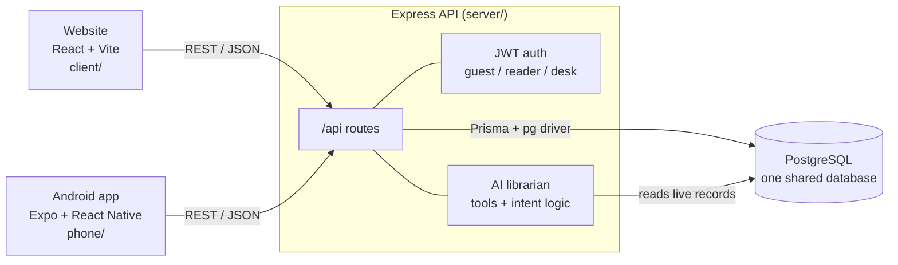
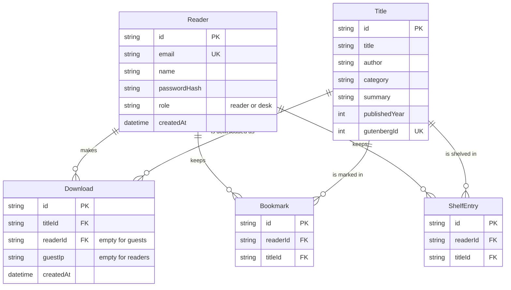
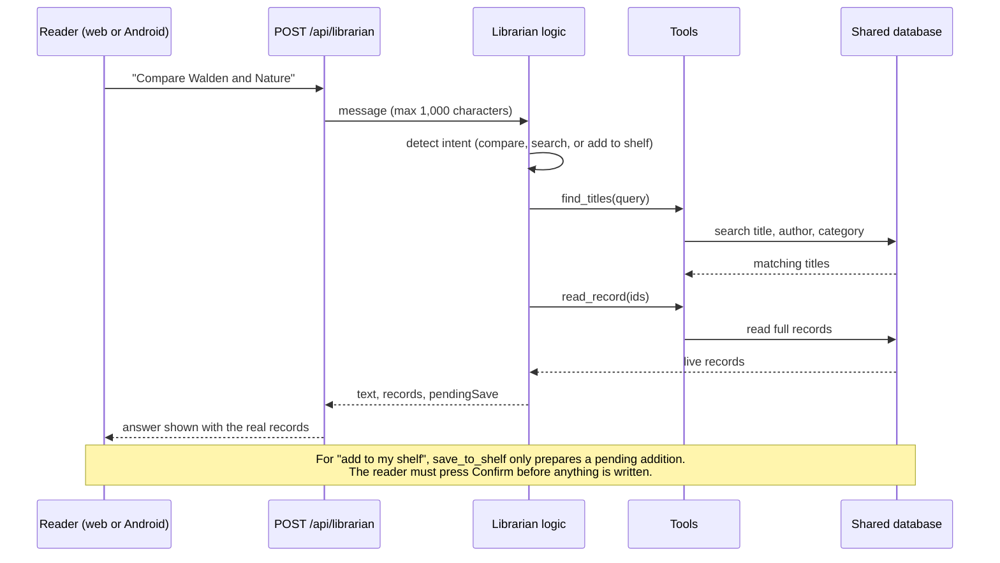
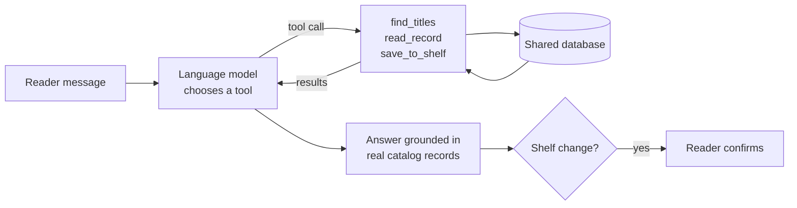

# Reading Room: System Architecture

Reading Room (E-Library-LAT) is a public-domain library with one shared backend, one shared database, a website, an Android app and an AI librarian. This document describes how the pieces fit together and how the AI agent is built and planned.

Sections marked **Implemented** describe what the code does today. Sections marked **Planned** describe intended next steps and are not built yet.

## 1. System overview (Implemented)

- The website and the Android app are both clients of the same REST API. Neither talks to the database directly.
- Because both clients use the same API and the same database, accounts, shelves, bookmarks and download counts are shared automatically.
- In production, Express also serves the built website, so the site and the API share one address.

## 2. Components (Implemented)

| Part | Location | Technology | Purpose |
|---|---|---|---|
| Website | `client/` | React, TypeScript, Vite | Catalog, search, book details, shelf, account, librarian panel, desk (admin) dashboard |
| Android app | `phone/` | Expo, React Native | Library, shelf and account tabs, book details, librarian sheet |
| API | `server/src/http/` | Node.js, Express | REST routes for sessions, catalog, downloads, shelves, desk and librarian |
| Database | `server/prisma/schema.prisma` | PostgreSQL via Prisma | Shared data store |
| Hosting | `app.yaml`, `Dockerfile` | Wasmer Edge, Docker | Deployment targets |

## 3. Database structure (Implemented)

- Passwords are stored as bcrypt hashes, never as plain text.
- A reader can shelve or bookmark a title only once (unique on reader and title).
- Deleting a reader removes their bookmarks and shelf entries. A title that has downloads, bookmarks or shelf entries cannot be deleted, and neither can a reader who has download records.

## 4. Users, access and authentication (Implemented)

| Role | How they get in | What they can do |
|---|---|---|
| Guest | `POST /api/session/guest` (no account) | Browse, search, view details, download up to 5 distinct title cards per IP address |
| Reader | `POST /api/session/register`, then `/login` | Everything a guest can, plus shelf, bookmarks and up to 10 distinct downloads |
| Desk (librarian) | Account with role `desk` (created from environment settings on first start) | Everything a reader can, plus the desk dashboard and book management |

Sign-in returns a signed JWT that is valid for 14 days. Clients send it as `Authorization: Bearer <token>`. Logging out clears the token on the client. In production the server refuses to start unless `JWT_SECRET` is set to a random value of at least 32 characters.

## 5. REST API (Implemented)

| Area | Routes |
|---|---|
| Session | `POST /api/session/guest`, `/register`, `/login`, `/logout`, `GET /me` |
| Catalog | `GET /api/titles` (filters: `title`, `author`, `category`, `q`, `page`, `limit`), `GET /api/titles/:id` |
| Downloads | `GET /api/downloads/:titleId/card.pdf` (creates a bibliographic card and records the download) |
| Shelf and bookmarks | `GET /api/shelves`, `POST /api/shelves`, `DELETE /api/shelves/:titleId`, `POST` and `DELETE /api/shelves/bookmarks...` |
| Desk (librarian only) | `GET /api/desk/summary`, `POST /api/desk/titles`, `PUT /api/desk/titles/:id`, `DELETE /api/desk/titles/:id` |
| AI librarian | `GET /api/librarian/tools`, `POST /api/librarian` |
| Health | `GET /api/health` |

## 6. AI agent architecture

### 6.1 Current design (Implemented)

The librarian is an assistant connected to the real catalog. It never answers from invented data: every record it returns is read from the database at the moment of the request.

The agent's tools (listed by `GET /api/librarian/tools`):

| Tool | What it does | Writes data? |
|---|---|---|
| `find_titles` | Searches the live catalog by title, author or category | No |
| `read_record` | Reads the full records for a list of title IDs | No |
| `save_to_shelf` | Prepares a shelf addition for the reader to confirm | No. Only the reader's Confirm button saves it |

Supported requests today: look up a title, author or category, compare two titles, and add a title to the shelf (with confirmation).

How it decides what to do: the current version recognises the request type with pattern matching (for example the words "compare" or "add ... shelf"), then calls the tools above. It does not use a language model yet.

Safety rules built into the design:
- The tools only read the catalog. Nothing is changed without the reader's explicit confirmation.
- Messages are limited to 1,000 characters.
- The agent only sees the public catalog, never other readers' accounts, passwords or downloads.

### 6.2 Planned next steps (Planned, not built)

- Replace the pattern matching with a language model that decides which tool to call, calls it, reads the results and writes the answer. The three tools and the confirmation rule stay the same.
- Add recommendations (for example "something like this book") that use only titles found in the catalog.
- Keep the model on the server, so API keys never reach the website or the phone.
- Test the agent with a fixed list of example questions and check that every title in an answer exists in the database.

## 7. Deployment (Implemented)

- **Docker:** `docker compose up --build` runs the API (with the built website) and PostgreSQL.
- **Wasmer Edge:** `wasmer deploy --build-remote` builds and runs the app with Wasmer's managed PostgreSQL. See the README for the steps.
- The server creates its tables on startup (`server/src/data/schema.ts`) and loads a starting catalog of public-domain titles on the first run.
